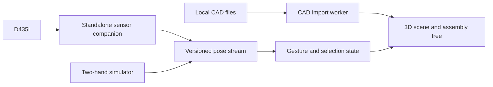

# Spatial CAD Workbench

## Exhibit concept

Build a standalone 3D exhibit where a visitor can reach into a virtual workspace and explore a team's engineering. The demo starts with a complete car. A visitor highlights a wheel, pinches to pull it forward, brings in their other hand to turn or enlarge it, then picks a color and restores the assembled view. An operator can load a different car, an assembly, or a set of individual parts before a session.

The project lives alongside PurpleExperience in its own directory. It will have its own frontend, sensor companion, dependencies, launch commands, loopback port, calibration profiles, and runtime data. Launching the workbench starts only its own services. The earlier PurpleExperience sensor work provides a reference for capture and calibration.

## Platform and runtime

Start with a TypeScript browser workspace using Three.js and WebGL 2, plus a separate Python companion using librealsense and MediaPipe. The renderer gives us control of the full scene, its camera, and the picking and feedback for each component. On Windows and Linux the companion serves the workspace and its pose stream on the same loopback origin. Package the UI, import code, hand model, and sample exhibit locally so a prepared workstation can run offline. [Three.js renderer](https://threejs.org/docs/pages/WebGLRenderer.html) · [Scene objects](https://threejs.org/docs/pages/Object3D.html) · [RealSense SDK](https://github.com/realsenseai/librealsense)

| Target | Planned path |
| --- | --- |
| Windows and Linux | Full workspace with simulator first, then USB D435i capture on the exhibit computer. Verify both operating systems on the intended graphics hardware. |
| Android display | Try the browser renderer first. For a live demo, pair it with the desktop sensor companion on the exhibit LAN. Use a calibration for that display and measure latency over the link. |
| Android with the camera attached | Separate feasibility check for a specific device with USB 3 host support, sufficient power, and the native RealSense wrapper. RealSense documents Android integration and lists Windows and Linux as its validated platforms. [RealSense Android documentation](https://github.com/realsenseai/librealsense/blob/master/doc/android.md) |

Godot is the native fallback if the browser misses the exhibit's measured rendering or packaging needs. It can load glTF at runtime and has desktop and Android export paths. Keep the CAD conversion and pose protocol independent so a renderer change can reuse both. Flutter is a possible app shell, with more renderer and picking work for this prototype. [Godot runtime file loading](https://docs.godotengine.org/en/stable/tutorials/io/runtime_file_loading_and_saving.html) · [Godot Android export](https://docs.godotengine.org/en/stable/tutorials/export/exporting_for_android.html) · [Flutter 3D support](https://docs.flutter.dev/resources/faq#can-i-build-3d-apps-with-flutter)

## CAD import and scene data

- **STEP and STP.** Evaluate `occt-wasm` in a Web Worker. Its XCAF API can read STEP, walk assembly references and their placements, and export GLB for the renderer. Try the GLB path first and check it against the source assembly. If it loses needed hierarchy, metadata, or placement, build the scene from the XCAF occurrence tree. If browser conversion is impractical on the exhibit hardware, use a separate native OCCT XDE converter that produces GLB and an occurrence manifest. [occt-wasm assembly API](https://github.com/andymai/occt-wasm) · [OCCT STEP and XDE guide](https://github.com/Open-Cascade-SAS/OCCT/blob/master/dox/user_guides/step/step.md)
- **STL.** Support binary and ASCII. Treat each file as a mesh part and allow operators to group several files into a scene. Ask for source units and make the choice visible in the import preview. STEP and STL imports use a common scene unit and up-axis convention. GLB can also serve as a preconverted asset for large exhibits. [Three.js STL loader](https://threejs.org/docs/pages/STLLoader.html) · [glTF specification](https://registry.khronos.org/glTF/specs/2.0/glTF-2.0.html)
- **Selectable occurrences.** Give every placed instance its own ID, parent, pivot, initial transform, and material override. A wheel can share geometry with the other wheels while retaining independent selection and color. Keep user edits and reversible explode offsets separate from imported placement. Support selecting a leaf or an assembly group, restoring a part or the assembly, and undoing one edit per completed grab.
- **Import gate.** Use a small nested STEP fixture with repeated parts at different positions and rotations, then one representative car export from Fusion. Compare hierarchy, placements, dimensions, and available names and colors. Move and recolor one repeated part and verify that the others stay in place and keep their color. Include a single STL, several separate STLs, a damaged file, and a large model. Show import progress or an actionable error while keeping the current exhibit usable.

## Hands and navigation

1. **Aim and grab.** Show a restrained cursor for each tracked hand. Ray-pick the visible component and outline it before a pinch. A deliberate thumb–index pinch latches the part or assembly until release. Move one hand sideways, vertically, or in depth to translate the part relative to the grip start. Offer a simple assembly list to select a hidden or hard-to-hit component.
2. **Use both hands on a part.** While a part is held, show a large join handle beside it so a second hand has room to pinch and join the grip. Capture the current object pose and both hand positions. The midpoint moves the object, the change in separation scales it uniformly, and the change in direction of the line between hands rotates it. Clamp scale and require a usable hand separation before applying rotation or scaling. Rotation about that line is ambiguous with two points. Use a dedicated rotation control if testing shows that full twist is needed. [Microsoft two-hand manipulation reference](https://learn.microsoft.com/en-us/dotnet/api/mixedreality.toolkit.spatialmanipulation.objectmanipulator?view=mrtkspatialmanipulation-3.2)
3. **Release and recover.** On deliberate release of one hand, rebase at the current pose so the remaining hand can continue without a jump. If tracking drops, depth becomes invalid, or hand identity is ambiguous, hold the part at its last pose and ask for a fresh pinch. A held grip owns its original target. A passerby or a newly detected hand cannot take it over.
4. **Navigate the scene.** Start in **Parts** mode with a stable camera. In **View** mode, pinch and move to orbit around the assembly, and use a second grip to zoom by changing the distance between hands. Provide large **Fit**, **Front**, **Side**, and **Isometric** controls as shortcuts. Make the mode visible and end an active grab before changing modes. The demonstration uses hand input for part and camera navigation. The operator can use a conventional file picker and keyboard or touch for setup and recovery controls.
5. **Make it presentable.** Give the car a well-lit stage with a quiet background, clear outlines, and an optional engineering label for the selected component. Put large color swatches, **Undo**, **Explode**, and **Reassemble** within comfortable reach. Frame the whole assembly for the explode view. Use a short on-screen hand cue the first time someone reaches in, then show instructions beside the object only when they help. [Touchless onboarding guidance](https://docs.ultraleap.com/TouchFree/touchless-interfaces/guidance.html)

## Depth companion

Align RGB and depth from the D435i, detect up to two hands, sample valid depth around the palm and fingertips, and deproject to a common camera coordinate system. Calibrate a comfortable interaction volume and map it to the display and scene axes. Measure pinch spacing in 3D. Smooth movement with timestamps and use separate close and open thresholds so a shaky pinch stays held. Tune these settings on the mounted device. [RealSense projection and deprojection](https://dev.realsenseai.com/docs/projection-in-realsense-sdk-2-0/) · [MediaPipe hand results](https://ai.google.dev/edge/api/mediapipe/python/mp/tasks/vision/HandLandmarkerResult)

Keep a stable ID for each hand using spatial continuity, with handedness as a hint. Publish frame sequence, capture age, grip and palm positions, pinch state, depth validity, and tracking status. Use the newest frame and discard stale or reordered input. Both the simulator and sensor companion emit this contract. The workbench owns gesture interpretation and selection. Camera frames stay in the companion. A local diagnostic trace can capture numeric poses, frame ages, and reasons a grip ended for later replay.

## Milestones and evidence

1. **CAD and simulator.** After approval, build the separate launcher, run the import gate, and use scripted two-hand poses and keyboard-driven simulation to complete the exhibit walkthrough. Exercise pure translation, spread and squeeze, rotation, one-to-two-to-one hand transitions, transforms under a rotated parent, isolated recolor, and undo and restore. Replay dropped or reordered samples and hands crossing to check for jumps or wrong-target edits.
2. **D435i on the mounted display.** Verify recognition of both hands and deliberate grips at relaxed reach on Windows and Linux. Test different heights, either hand, overlapping fingers, brief occlusion, and camera reconnect. Confirm that motion stops on loss and resumes only after a fresh grip. Record real inference FPS, capture-to-display latency, resting drift, and the success rate for first attempts. Use the traces to separate tracking failures from interaction problems.
3. **Exhibit rehearsal.** Ask someone unfamiliar with the controls to pull out a part, turn it, recolor it, and restore the assembly using the on-screen cues. Watch where they need help. Measure import time, memory, and render frame time with the real exhibit model while tracking runs. Use those results to decide whether to keep the browser renderer, reduce mesh detail, or try Godot. Try Android rendering after the desktop walkthrough is reliable.
